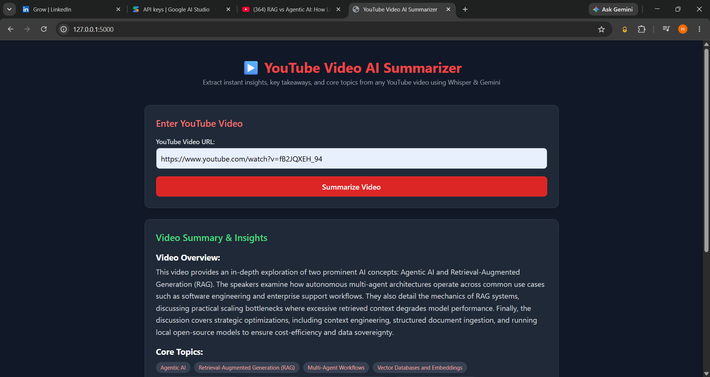
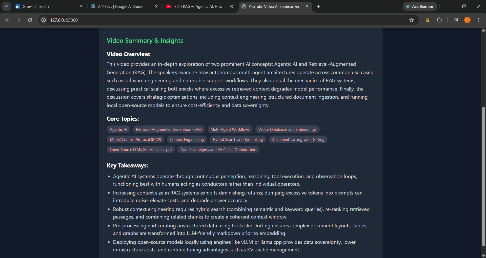

# 🎥 YouTube Video AI Summarizer

A lightweight, lightning-fast web application built with **Flask**, **Google Gemini API**, and a **hybrid transcription engine** that instantly extracts comprehensive summaries, core topics, and key takeaways from any YouTube video.

---

## 🌟 Key Features

* **⚡ Instant YouTube Caption Fetching:** Leverages `youtube_transcript_api` to instantly pull transcripts (supporting English, Hindi, and auto-generated captions) in seconds without downloading audio.
* **🎙️ Smart Whisper Fallback:** Automatically falls back to local Whisper transcription (`tiny` model via `yt-dlp`) for videos lacking captions or for complex non-English audio.
* **🤖 Google Gemini Powered:** Uses `gemini-3.8-flash` with strict Pydantic schema validation to guarantee structured, reliable, and high-quality JSON outputs.
* **🎨 Modern Dark-Mode UI:** Built with **Tailwind CSS**, featuring clean visual layouts for video overviews, badge-style core topics, and bulleted key insights[cite: 4, 5].

---

## 🛠️ Tech Stack

* **Backend:** Python, Flask
* **AI & Validation:** Google GenAI SDK (`gemini-3.8-flash`), Pydantic
* **Transcription & Audio:** `youtube_transcript_api`, OpenAI Whisper, `yt-dlp`
* **Frontend:** HTML5, Tailwind CSS

---

## 📁 Project Structure

```text
ai-meeting-assistant/
│
├── app/
│   ├── services/
│   │   ├── summarizer.py       # Gemini API integration & Pydantic schema
│   │   └── transcriber.py      # Hybrid YouTube captions & Whisper fallback
│   ├── static/                 # CSS/Assets
│   ├── templates/
│   │   └── index.html          # Tailwind UI frontend
│   ├── __init__.py
│   └── routes.py               # Flask application routes
│
├── data/                       # Temporary local audio storage (git-ignored)
├── .env                        # Environment variables (git-ignored)
├── requirements.txt            # Python dependencies
└── run.py                      # Flask server entry point

## 📸 App Preview

### 1. Home & URL Input Screen
*Clean and modern dark-mode interface designed for instant video link ingestion.*


### 2. Video Summary & Insights
*Instant breakdown featuring Video Overview, clickable Core Topics badges, and structured Key Takeaways.*

